# EditSimple — User Manual

**English** · [Italiano](manual.it.md) · [Deutsch](manual.de.md) · [Français](manual.fr.md) · [Español](manual.es.md) · [Nederlands](manual.nl.md) · [Polski](manual.pl.md) · [Ελληνικά](manual.el.md) · [Shqip](manual.sq.md)

EditSimple is a video editing program for anyone who needs to **explain an
event or show evidence** in a video: a hand-off in the middle of a crowd, a
vehicle arriving, a person to follow or to make unrecognizable. You import
the footage, point out what matters and the program does the rest: arrows,
boxes, numbered points, zooms and pixelations **follow the subject on their
own** in the following frames, and where tracking goes wrong you just drag
the shape to the right place to correct it. In a few minutes you get an MP4
ready to show or to attach, with opening and closing slides, texts, logo and
the operator's signature.

The **Images** page does the same job on photographs: one or more photos on
a sheet, the same annotations, numbered points with their notes and a button
that **inserts the figure with its caption directly into Word**.

*Andrea Cumini — www.osintinfo.net — andrea@osintinfo.net*
*EditSimple is one of the [Seity](https://www.seity.com) tools.*

> **A note on the sample material.** The images in this manual use a stock
> video published on Pexels: a pedestrian street with ordinary passers-by.
> **The people who appear are not doing anything wrong**: the arrows, boxes,
> zooms and pixelations placed on them only serve to show how the program
> works, and the subjects were chosen at random. The two photographs on the
> Images page are by
> [Andrea Dalle Piatte](https://www.pexels.com/it-it/@andreadallepiatte/),
> published on Pexels.

## Contents

1. [What you can do](#1-what-you-can-do)
2. [Installation and first start](#2-installation-and-first-start)
3. [The window](#3-the-window)
4. [Configure page](#4-configure-page)
5. [A complete example, step by step](#5-a-complete-example-step-by-step)
6. [Correcting tracking with keyframes](#6-correcting-tracking-with-keyframes)
7. [The timeline](#7-the-timeline)
8. [The preview: zoom in and detach](#8-the-preview-zoom-in-and-detach)
9. [Opening, closing and in-between slides](#9-opening-closing-and-in-between-slides)
10. [Texts, images, elapsed time and frame number](#10-texts-images-elapsed-time-and-frame-number)
11. [Speeding up and slowing down](#11-speeding-up-and-slowing-down)
12. [Cut, delete, freeze frame](#12-cut-delete-freeze-frame)
13. [Transitions](#13-transitions)
14. [Audio](#14-audio)
15. [Exporting the video](#15-exporting-the-video)
16. [The Images page](#16-the-images-page)
17. [Tips for a good result](#17-tips-for-a-good-result)
18. [Keyboard and mouse shortcuts](#18-keyboard-and-mouse-shortcuts)
19. [The project files](#19-the-project-files)

## 1. What you can do

| Feature | In short |
| --- | --- |
| **Subject tracking** | Boxes, ovals, arrows, numbered points, zooms and pixelations follow a person, a face, an object or a vehicle; they grow and shrink with it as it moves toward or away from the camera; they end on their own when it leaves the frame. |
| **Correction keyframes** | Where tracking goes wrong (a pole, a person passing in front) you drag the shape onto the subject: the program corrects the path before and after that point. |
| **Arrows** | Ends at the tip, at the tail, on both ends or none; solid or open arrowhead, dot, small square, bar. In the video the tail can **stay fixed** while the tip follows the subject. |
| **Numbered points** | Small circles with a number (1, 2, 3) or a letter (A, B, C), always the one after the last placed; they follow the subject in the video; in images they have a note that goes into the caption. |
| **Zoom** | A small detail (hands, a license plate) magnified from 2x to 16x in a box, with an outline and a line connecting it to the object. Rectangular or oval. |
| **Pixelation** | Rectangular or oval, for faces and license plates; it follows the subject and grows with it. |
| **Texts and images** | Multi-line texts with background and rounded corners; images on top (a frame, a map, a document). |
| **Logo and signature** | Logo and operator text fixed in a corner, prepared once in Configure. |
| **Time and frames** | The elapsed time and the frame number written in the video, wherever you want. |
| **Slides** | At the start, at the end or in between; solid color or background image; you write texts and place images on top. |
| **Speed** | From 0.25x (slow motion) to 32x (fast forward), with a clock icon showing the speed. |
| **Cuts** | Cut at the cursor, deletion of a range, freeze frame, reordering of clips. |
| **Transitions** | Fade in from black, fade out to black, blend with the next clip. |
| **Audio** | Added tracks (commentary, music) with volume and fades; original audio with volume, fades and deletion of single stretches. |
| **Preview** | Playback with audio, backwards, frame by frame; zoomable preview that can be **detached** into a separate window. |
| **Export** | MP4 (H.264 + AAC) identical to the preview. |
| **Images** | One or more photos on a sheet (up to four, eleven layouts, five formats), the same annotations as the video plus the **link** between two points, numbered points with notes, the caption and the **Word** button; project saved in an editable JSON; sheet exported as PNG or JPG or copied to the clipboard. |
| **Languages and manual** | Interface in 9 languages, switchable without restarting; this manual opens inside the program, in the chosen language. |

## 2. Installation and first start

**Executable (Windows 10/11, 64-bit).** Extract the zip wherever you like and
start `EditSimple.exe`. Python is not needed.

**From source.** With Python 3.11:

```bash
python -m venv .venv
.venv\Scripts\python.exe -m pip install -r requirements.txt
.venv\Scripts\python.exe EditSimple.py
```

**FFmpeg.** EditSimple uses ffmpeg to read files and to export. It is not
included: at the first start, if it cannot find it, the **Configure** page
opens and the **Download / Update** button downloads it (official Windows
build) into the `tools\ffmpeg\` folder next to the program. No installation.

**VitTrack (optional).** On the same page, **Download** gets VitTrack, a small
model (0.7 MB) that helps tracking find the subject again after an obstacle.
Without it, tracking works anyway.

## 3. The window

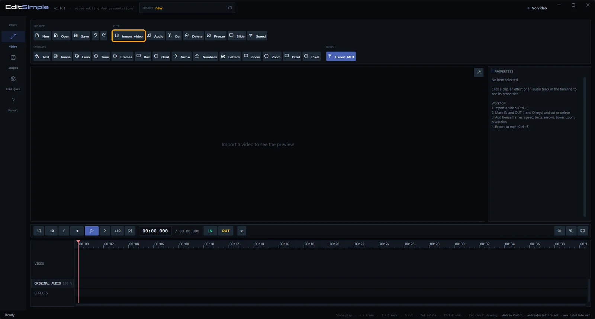

- **Bar on the left**, with the pages: **Video** (editing), **Images**
  (photographs, chapter 16), **Configure** and **Manual**, which opens this
  manual in a separate window, in the language of the interface.
- **Toolbar**, in four groups: *Project* (new, open, save, undo, redo),
  *Clip* (import video, audio, cut, delete, freeze frame, slide, speed),
  *Overlays* (text, image, logo, time, frames, box, oval, arrow, numbers,
  letters, rectangular and oval zoom, rectangular and oval pixel) and
  *Output* (export MP4). Each button has a tooltip with its shortcut.
- **Preview**, in the center: shows the frame at the cursor with all the
  effects, exactly as in the exported video. You draw and move the effects on
  it.
- **Properties**, on the right: the values of the selected item (a clip, an
  effect, an audio track).
- **Transport**: start, -10 frames, previous frame, play backwards, play,
  next frame, +10 frames, end; the cursor time (you can type it); IN, OUT and
  clearing the marks; on the right, the timeline zoom.
- **Timeline**, at the bottom: ruler, filmstrip **Video** track, **Original
  audio**, added audio tracks and **Effects**, one per row.

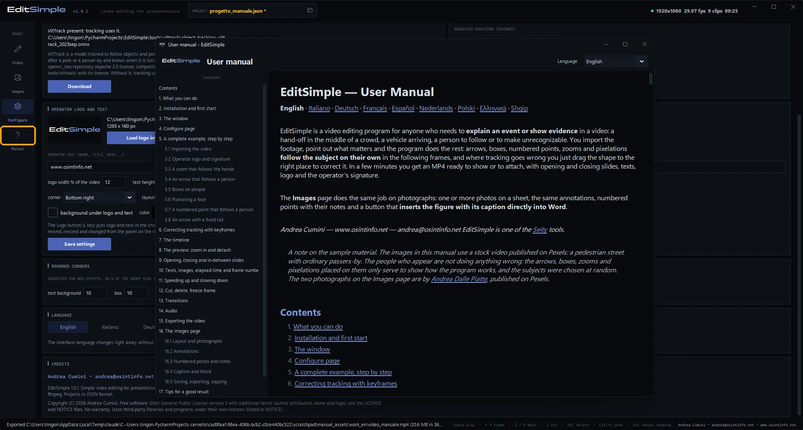

The **Manual** window has the list of chapters on the left (a click jumps to
the chapter) and the language menu at the top; the links in the text work,
and the images are the ones on these pages. The manual changes language
together with the interface.

## 4. Configure page

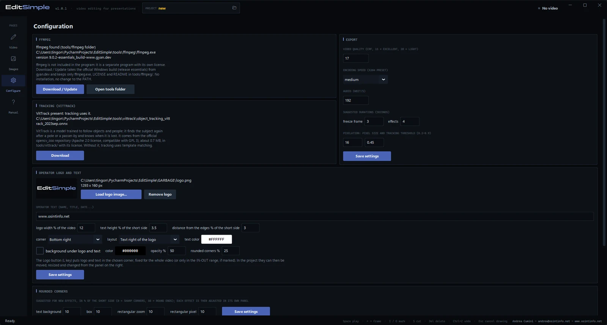

It opens from the bar on the left. It contains:

- **FFmpeg** and **Tracking (VitTrack)**: status, download and update.
- **Export**: video quality (CRF: 15 excellent, 28 light), encoding speed,
  audio quality, suggested durations for freeze frames and effects, default
  pixel size and tracking threshold (higher = stricter in recognizing the
  subject).
- **Operator logo and text**: the logo image (PNG with transparency or JPG),
  the text (name, organization, website), the logo width, the text height,
  the distance from the edges, the corner, the layout, the colors and a
  background with opacity and rounded corners. You prepare them once; then
  the **Logo** button puts them in the video (and on the image sheet).

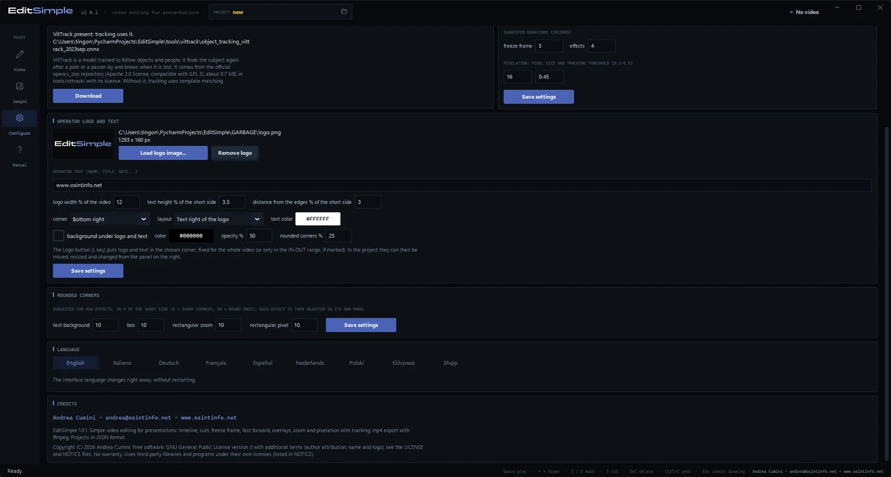

- **Rounded corners** of the background of texts, boxes, rectangular zoom and
  rectangular pixelation.
- Interface **Language**: English, Italiano, Deutsch, Français, Español,
  Nederlands, Polski, Ελληνικά, Shqip. The change is immediate.

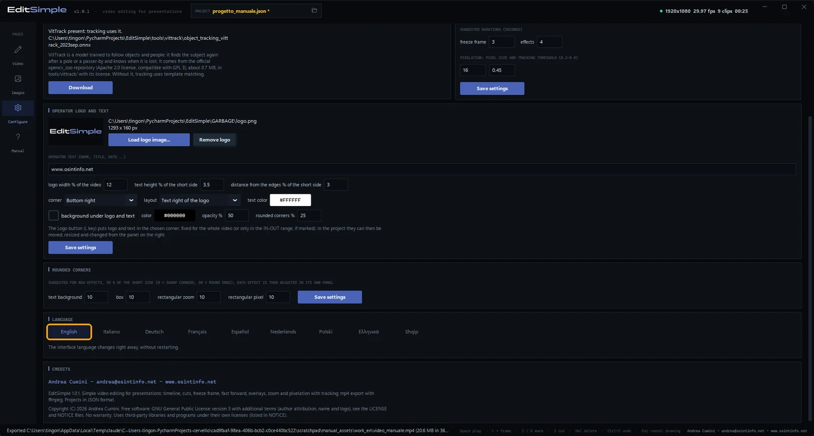

## 5. A complete example, step by step

The example in this chapter is a 19-second video shot in a crowded pedestrian
street (see the note at the top: the passers-by are not doing anything
wrong). In a few steps we enrich it: the operator's logo and website at the
bottom, a zoom on a man's hands that follows their movements, an arrow
pointing at a person for 12 seconds, two boxes on other people, the
pixelation of a face at the end, a numbered point that follows a person and
an arrow with a fixed tail pointing at a phone for the whole video.

### 5.1 Importing the video

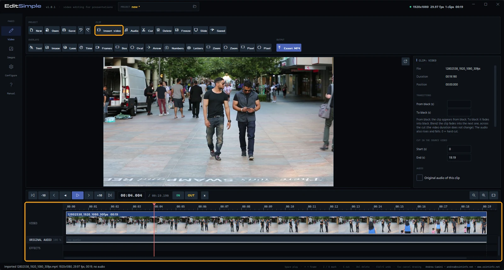

**Import video** (Ctrl+I) opens the footage. The first video sets the size
and frame rate of the project (here 1920×1080, 29.97 frames per second). The
clip appears in the Video track as a filmstrip of frames; its audio in the
Original audio track (this video has none). Other videos are added at the end
or at the cursor.

You move the cursor with a click on the ruler, with the ← → arrows (one
frame), Ctrl+← → (ten frames), Shift+← → (one second), Home and End, or by
typing the time in the box. **Space** plays with audio, **Shift+Space** plays
backwards.

### 5.2 Operator logo and signature

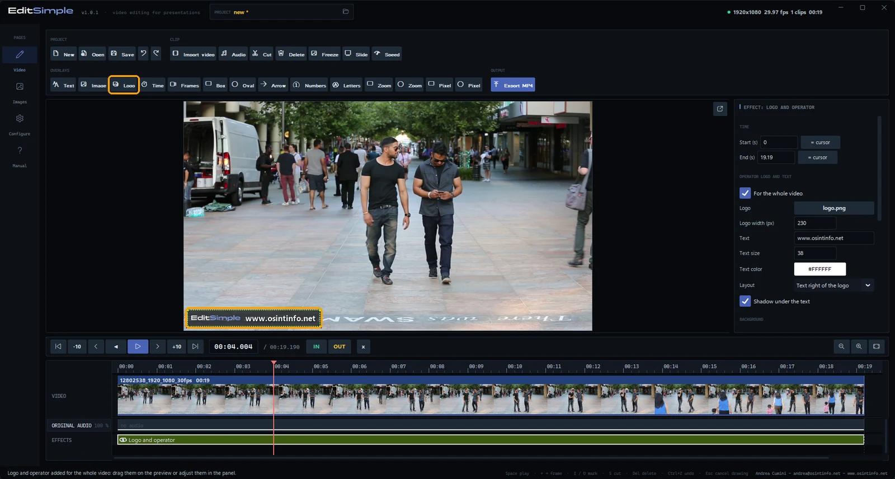

**Logo** (L) puts the logo and text prepared in Configure over the whole video
(or only between IN and OUT, if they are marked). On the preview you move
them by dragging and resize them from the corners; in the panel you change
text, colors, background, corner and opacity.

### 5.3 A zoom that follows the hands

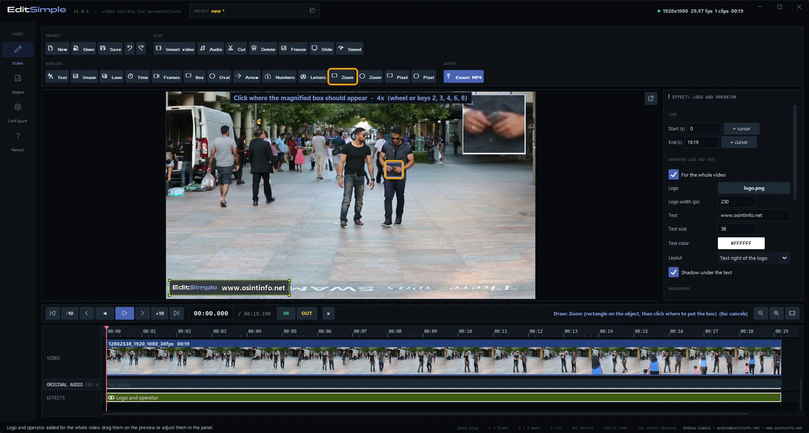

**Zoom** (Z) works in two steps:

1. drag a rectangle around the detail (here the man's hands);
2. the magnified box with the real content appears under the mouse: a click
   places it. You choose the magnification at that moment with the mouse
   wheel or with the 2, 3, 4, 6, 8 keys (up to 16x from the panel).

The zoom **starts following the object right away**: a window shows the
tracking progress.

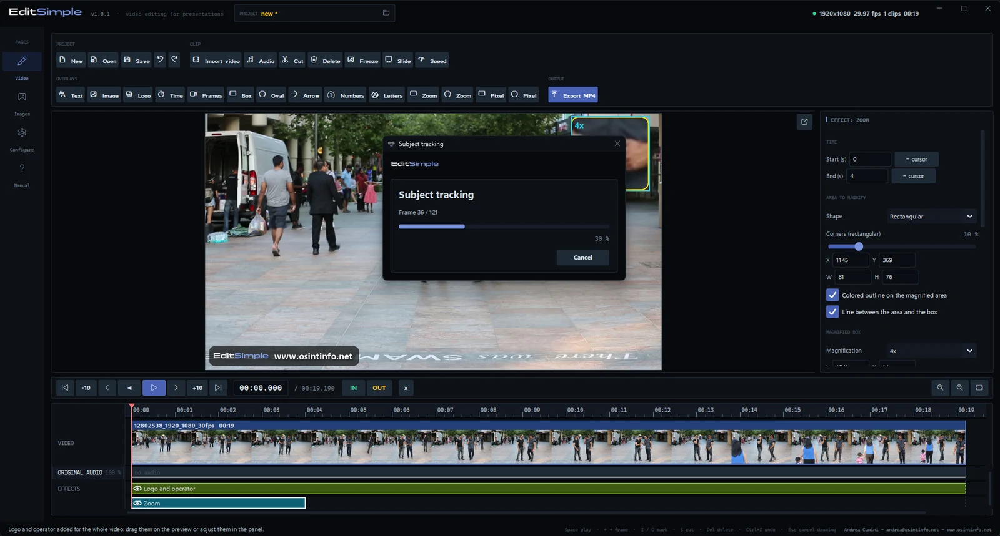

The magnified area follows the hands and grows or shrinks as the man moves
closer or farther away; the magnified box stays where we put it. A colored
outline marks the object and a line connects it to the box. Shift+Z creates
an oval zoom.

### 5.4 An arrow that follows a person

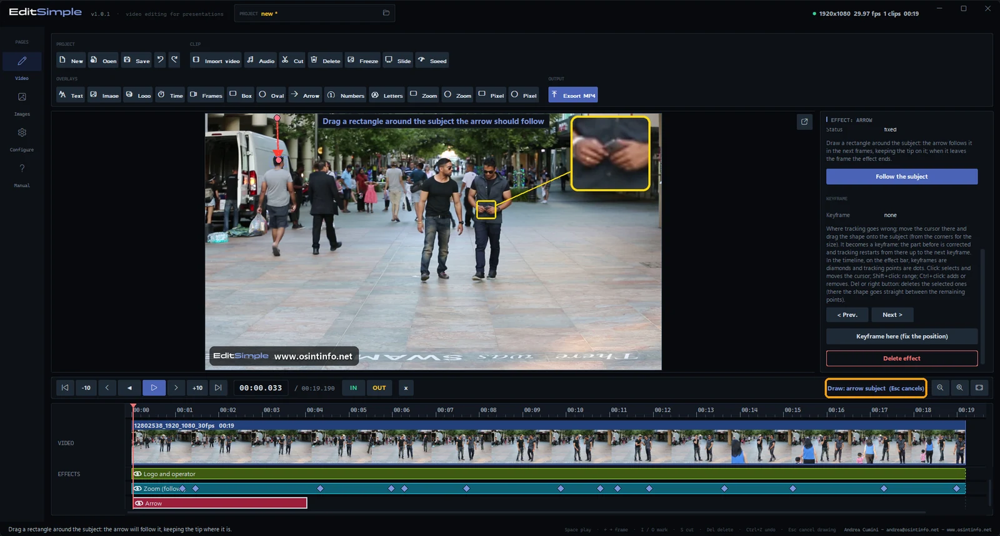

**Arrow** (A): drag from the tail to the tip. To make it follow a person,
press **Follow the subject** in the panel (or *Repeat tracking from the
cursor*) and draw a **rectangle around the subject**: the arrow follows it,
keeping the tip on it.

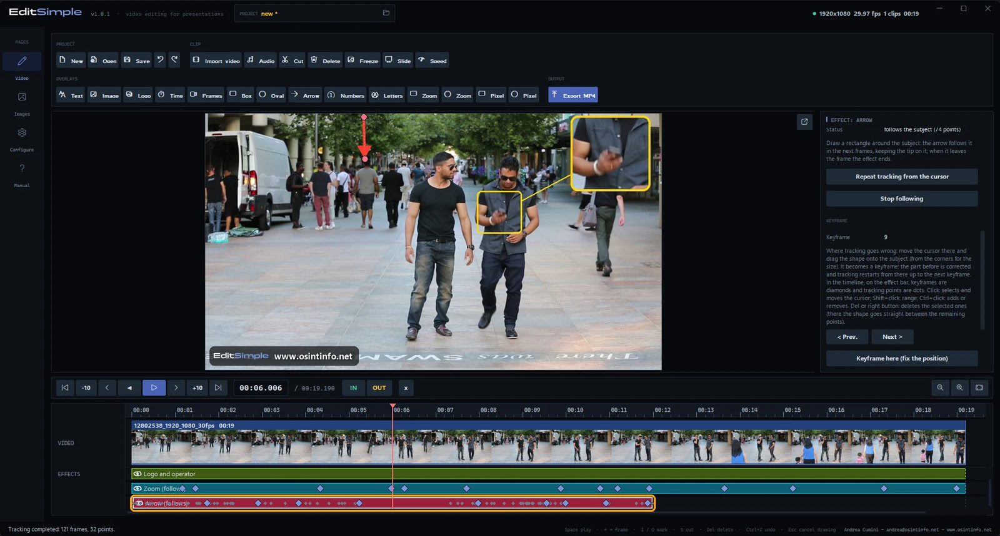

In the timeline the arrow's bar shows *(follows)* and the diamonds of the
keyframes we used to correct the path (see chapter 6).

In the arrow panel you also choose the **Ends** (at the tip, at the tail, on
both ends, none: line only) and the **End style**: solid arrowhead, open
arrowhead, dot, small square or bar. With two ends the arrow shows a
connection between two things.

### 5.5 Boxes on people

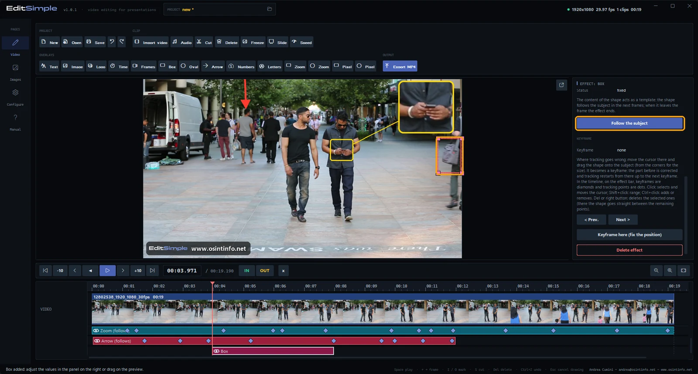

**Box** (R) and **Oval** (E): drag them on the preview. In the panel you
choose color, thickness, fill, rounded corners and opacity; **Follow the
subject** makes them track what they contain. When the person leaves the
frame, the shape goes out with them and the effect ends.

### 5.6 Pixelating a face

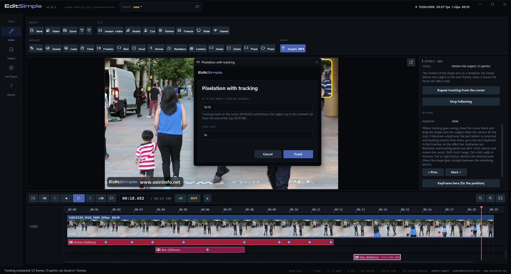

**Pixel** (P rectangular, K oval): drag a box over the face; a window asks how
long to track it and the pixel size.

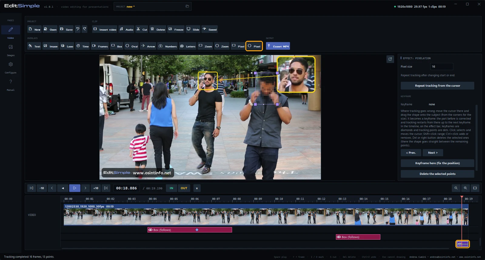

The pixelation follows the face and **grows as it gets closer** to the
camera, so it always covers it. If the subject leaves the frame, the
pixelation goes with it until it is completely out: no frame is left
uncovered.

### 5.7 A numbered point that follows a person

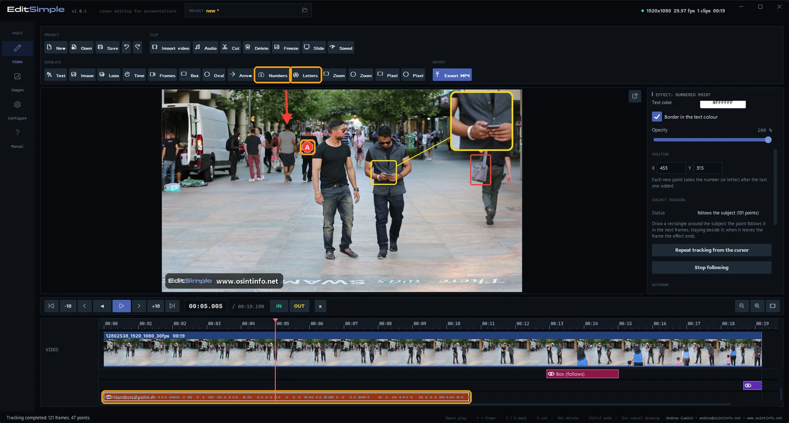

**Numbers** (N) and **Letters** (Shift+N) place a **numbered point**: a small
circle with a number (1, 2, 3...) or a capital letter (A, B, C...) inside.
Press the button and click where the point goes; **every point needs a new
click on the button**, and it always takes the number or letter after the
last one placed (after Z comes AA). In the panel you change the number or
the letter, the diameter, the color of the circle and of the text, the white
ring and the opacity.

Like the other shapes, the point **follows the subject**: *Follow the
subject* and a rectangle around the person. In the video the points have no
notes; they are there so you can refer to "person A" or "object 2" in the
commentary or in a slide.

### 5.8 An arrow with a fixed tail

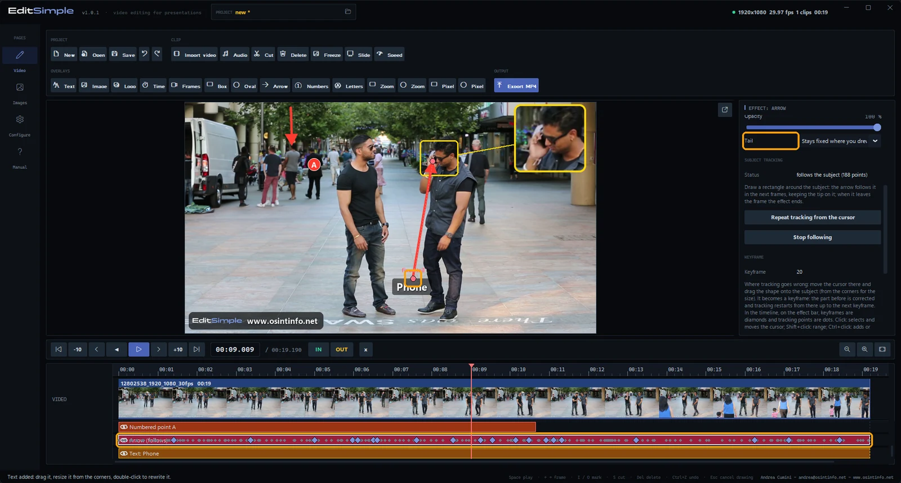

An arrow that follows a subject normally moves as a whole. The **Tail**
choice in the panel has the alternative **Stays fixed where you drew it**:
the tail stays at the point of the first frame and only the **tip follows
the subject**. It is useful when the tail starts from a text or from a
reference point: here the "Phone" label stays at the bottom and the arrow
stretches and shortens to stay on the phone for the whole video.

Dragging the tail handle really moves the tail there; dragging the tip or
the line creates a keyframe, as for the other shapes.

## 6. Correcting tracking with keyframes

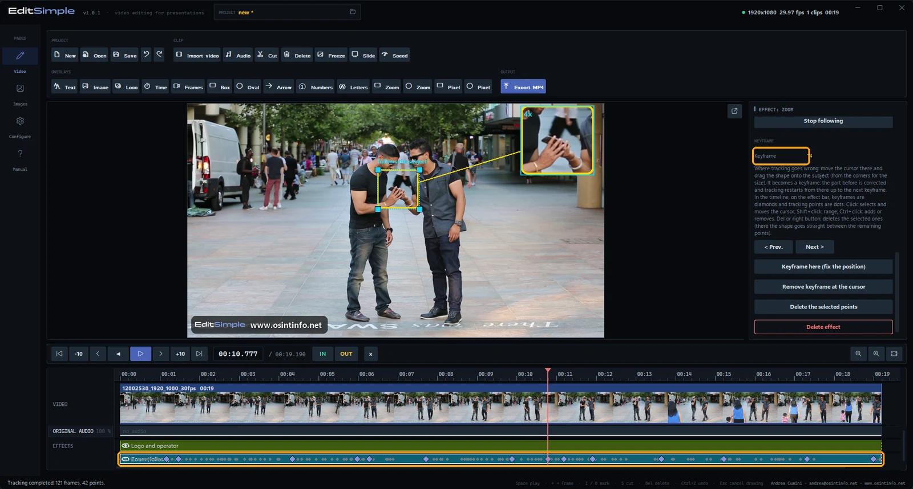

Tracking is automatic, but a real video has obstacles: a pole, a person
passing in front, a subject turning around. Where the shape goes wrong:

1. move the cursor to that frame;
2. **drag the shape onto the subject** in the preview (or resize it from the
   corners).

A **keyframe** is created (a diamond on the effect bar). The program corrects
the path before the keyframe, gradually, and **restarts tracking from
there** up to the next keyframe. You can add as many keyframes as you need:
the zoom in the example has 14, the arrow 9.

On the bar of the selected effect you also see the points found by tracking
(dots). A click selects a point and moves the cursor there, Shift+click
selects a range, Ctrl+click adds or removes; **Delete** or the right mouse
button deletes the selected points. In the panel, the **Keyframe** section
has the *< Prev.* and *Next >* buttons, *Keyframe here* (fixes the current
position) and *Remove keyframe at the cursor*.

## 7. The timeline

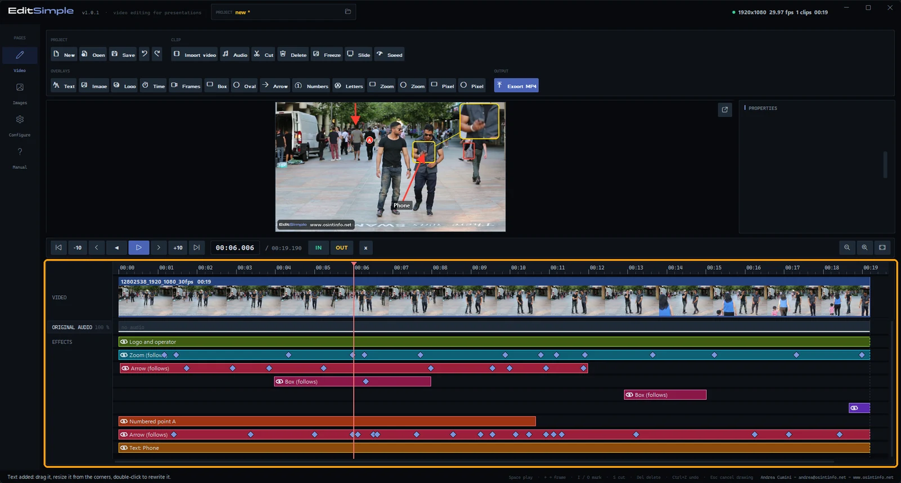

- **Effect bars**: **each effect has its own row**, in the order it was
  added, so no bar covers another. You move them by dragging; the right edge
  changes the duration. With many effects the audio and effects area
  **scrolls vertically** (scroll bar on the right, mouse wheel over the row
  names or Shift+wheel), while ruler and video stay fixed at the top.

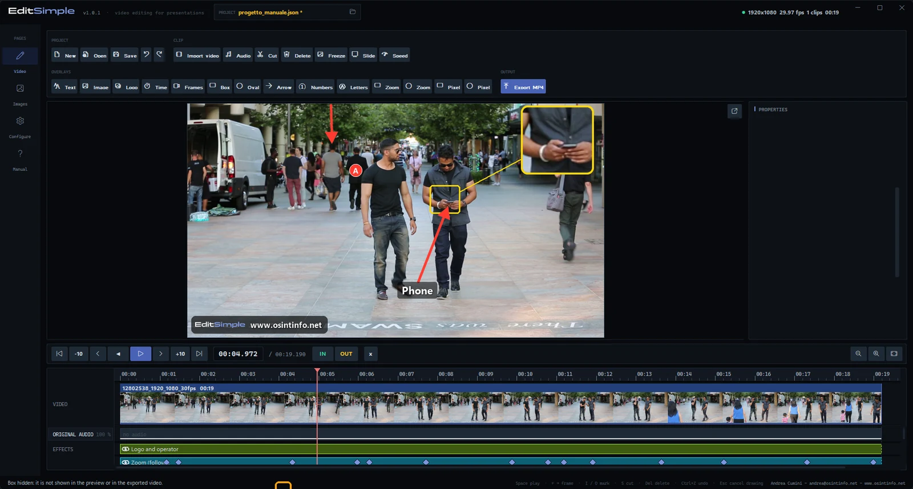

- **Eye**: the icon to the left of each bar **hides or shows** the effect, in
  the preview and in the exported video. Useful when many effects overlap
  while you work.
- **Right-click on a bar**: *Extend to cursor* (if the cursor is past the
  end; if the effect follows a subject, tracking continues up to the cursor
  and, if the subject is lost before that, the shape stays still where it
  was last seen) and *Stop at cursor* (if the cursor is inside the effect).
- **Timeline zoom**: Ctrl+wheel, or the − + buttons and *Fit the timeline*.
  Close up, the filmstrip shows every single frame.
- **Scrolling**: mouse wheel, Alt+drag or drag with the middle button.
- **Divider**: drag the thin strip above the playback controls up or down to
  give more room to the timeline or to the preview.

## 8. The preview: zoom in and detach

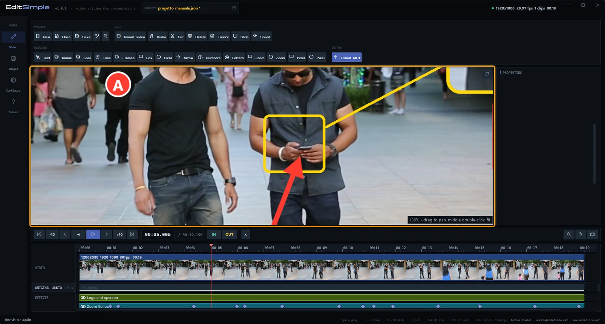

- **Ctrl+wheel** on the preview zooms in around the mouse, up to 16 times: to
  place a zoom precisely on a small detail or to check a pixelation. You pan
  by dragging on an empty spot (or with the middle button); a double-click
  with the middle button returns to the full view.
- **Detaching the preview**: the button at the top right of the preview opens
  it in a **separate window**, to put on a second monitor or wherever you
  like; the timeline takes all the space. The same button (or closing the
  window) **docks it again**. Shortcuts also work in the detached window.

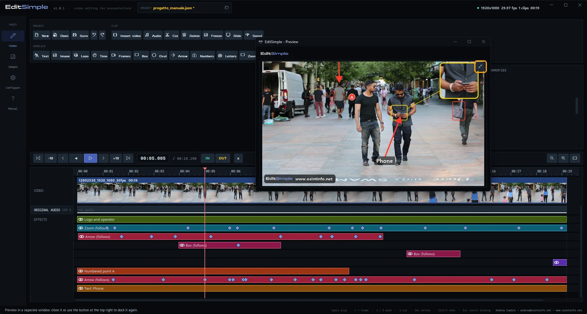

## 9. Opening, closing and in-between slides

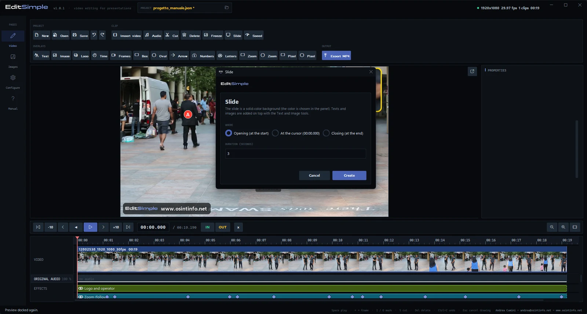

**Slide** inserts a slide **at the start** (opening), **at the cursor** (in
the middle of the video) or **at the end** (closing), with the chosen
duration. The slide is a solid-color background or a **background image**
fitted to the video size (fill, fit or stretch); color and image are chosen
in the panel. The effects that follow move forward together with the video.

On top of the slide you write texts and place images with the **Text** and
**Image** tools: with the cursor on the slide they last as long as the slide.

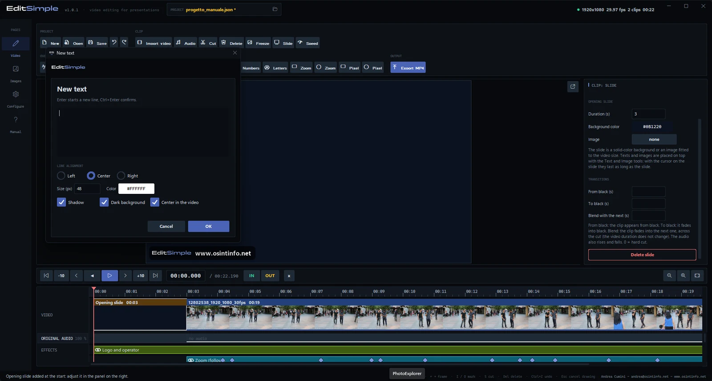

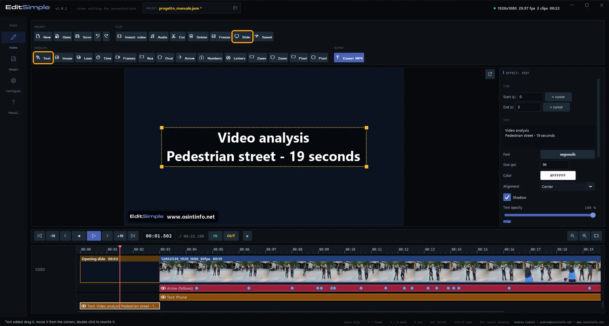

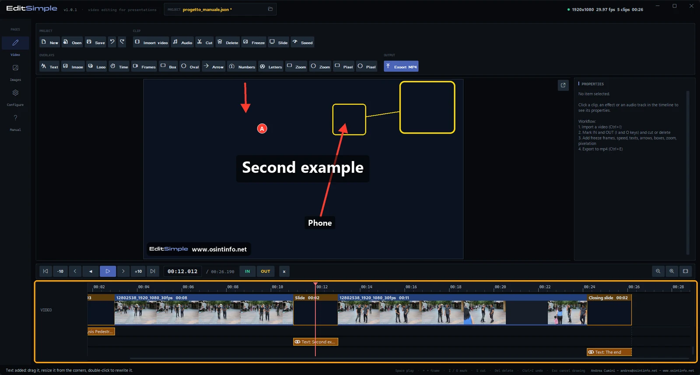

## 10. Texts, images, elapsed time and frame number

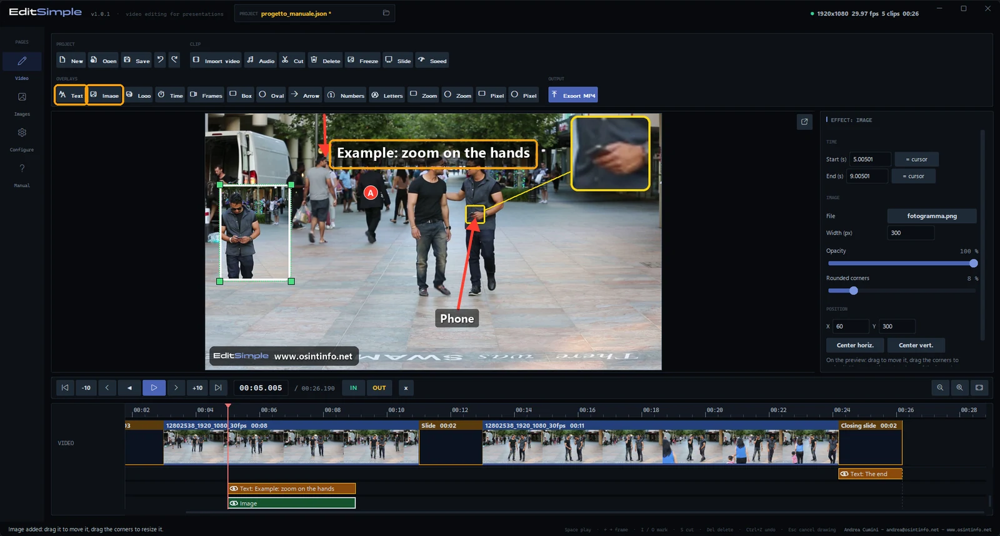

- **Text** (T): a click on the preview opens the text window: multiple lines,
  alignment, size, color, shadow, background (with opacity and rounded
  corners), centering. Double-click a text to rewrite it. In the panel there
  is also the font, chosen from a list that shows each font.
- **Image**: choose a file (PNG, JPG...) and it is placed in the center; you
  move and resize it on the preview; in the panel, opacity and rounded
  corners. Here it is a magnified frame of the subject, but it can be a map,
  a document, a photo.

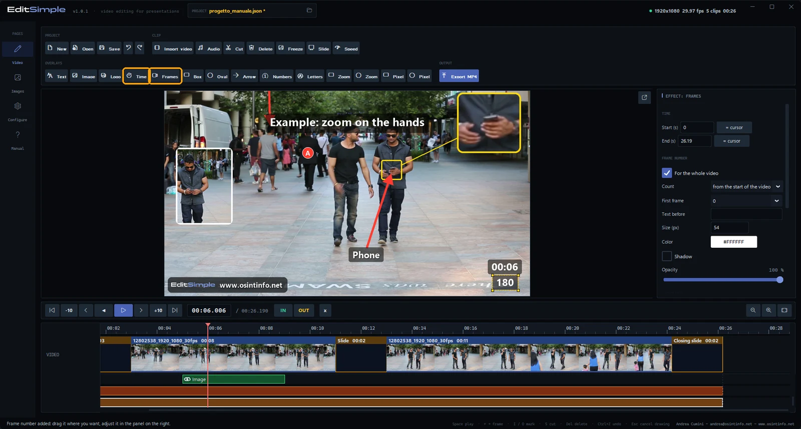

- **Time**: the elapsed time (01:23, 00:01:23 or with tenths), from the start
  of the video or from the start of the effect, with an optional text in
  front. Past one hour, the hours appear.
- **Frames**: the frame number, from 0 or from 1, from the start of the video
  or of the effect. Useful for citing an exact moment.

Both have background, opacity and rounded corners, and you place them
wherever you want with a click.

## 11. Speeding up and slowing down

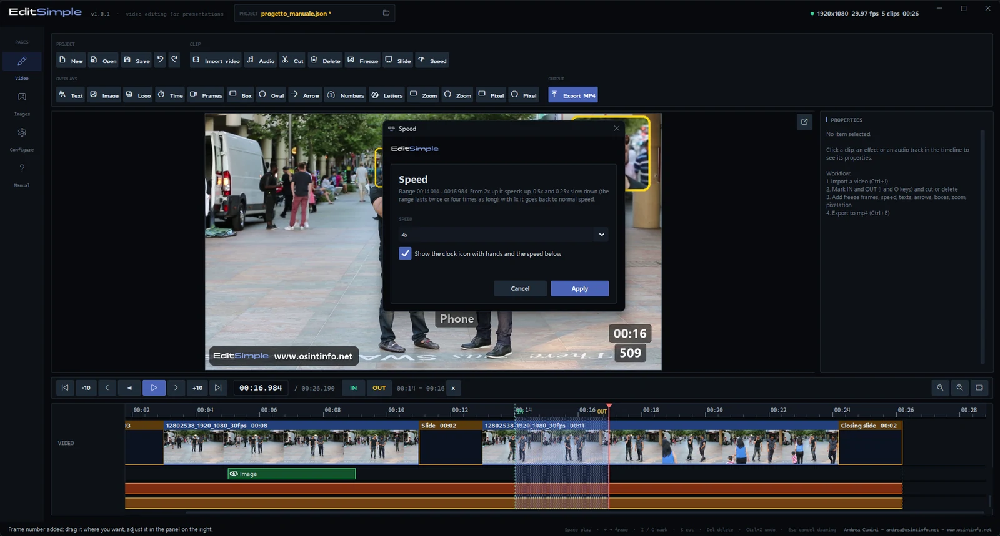

Mark a range with **IN** and **OUT** (I and O keys) and press **Speed** (V).
From **2x to 32x** the video speeds up; **0.5x and 0.25x** slow it down. The
**clock** option shows an icon with turning hands and the speed written
below, so viewers know that time is running faster. The timeline gets
shorter or longer; with 1x you go back to normal speed. Position, size and
color of the clock are adjusted in the clip panel.

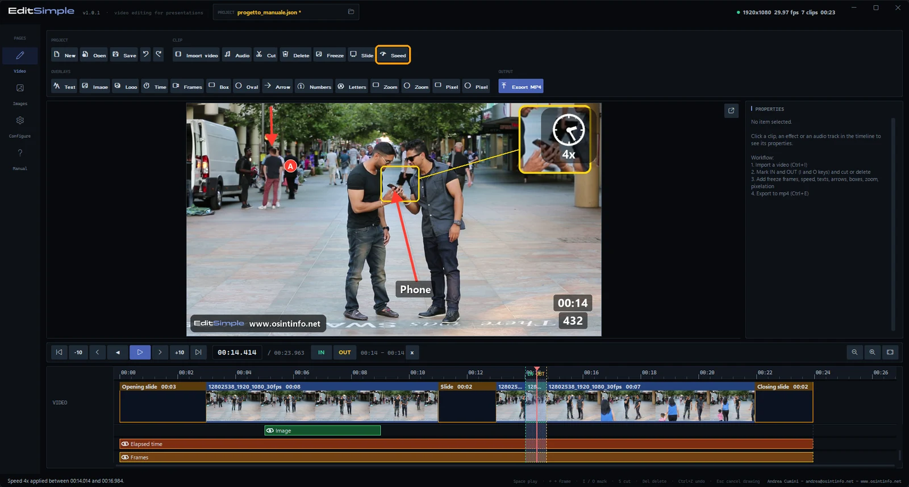

## 12. Cut, delete, freeze frame

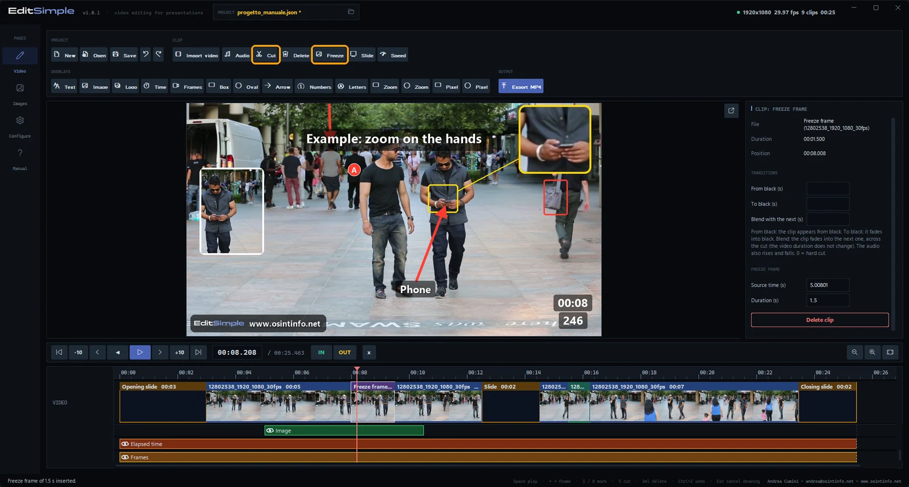

- **Cut** (S) splits the clip at the cursor. You **reorder clips by
  dragging them** in the timeline.
- **Delete** (Delete) removes the range between IN and OUT, or the selected
  item: what follows moves back, together with the effects.
- **Freeze** (F): the frame at the cursor stays still for the chosen number
  of seconds; what follows moves forward.

Everything can be undone with Ctrl+Z and redone with Ctrl+Y.

## 13. Transitions

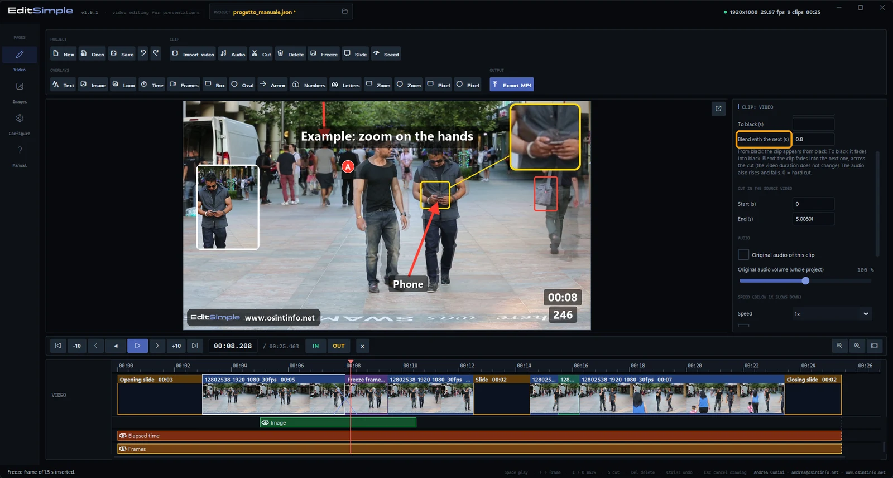

When you select a clip, the panel has the **Transitions** section:

- **From black**: the clip appears from black;
- **To black**: the clip fades into black;
- **Blend with the next**: the clip fades into the next one across the cut.
  The outgoing clip stays still during the blend; the video duration does
  not change.

The audio also rises and falls with the transitions. 0 means a hard cut.

## 14. Audio

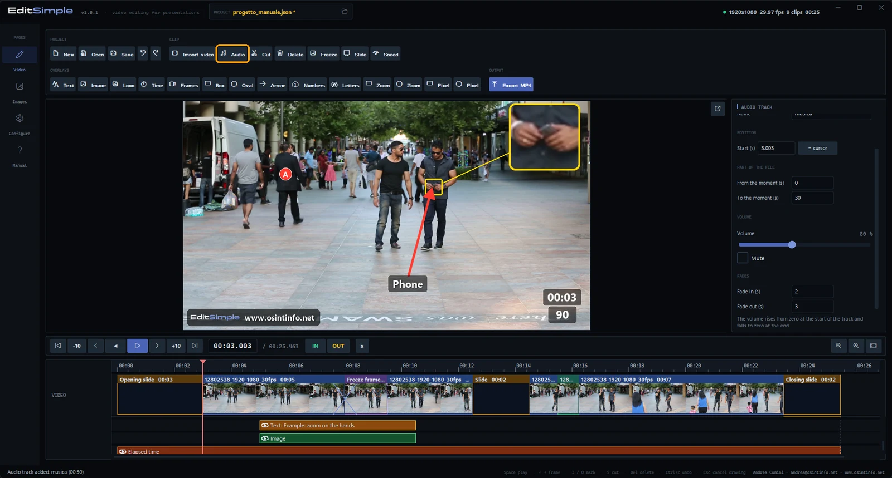

- **Audio** adds a track (commentary, music) at the cursor. In the panel:
  name, position, part of the file, **volume**, mute and **fades** in and
  out. You move it by dragging; a click on its name selects all of it,
  Delete removes it.
- The **white line** above each track shows the volume curve: fades and
  transitions are visible at a glance.
- **Original audio**: a click on the row name selects all the audio of the
  video (volume, fades at the start and at the end, deletion); a click on a
  piece selects only that piece (volume, fades, mute). With IN and OUT marked
  and the original audio selected, Delete removes **only the audio** of that
  stretch: the video stays.
- Playback in the preview is **with audio** (mixed as in the export).

## 15. Exporting the video

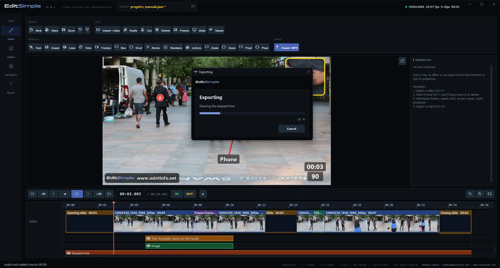

**Export MP4** (Ctrl+E) chooses the file and creates the video with ffmpeg:
H.264 and AAC, quality and encoding speed set in Configure. The result is
identical to the preview. The export can be cancelled; at the end the program
offers to open the folder.

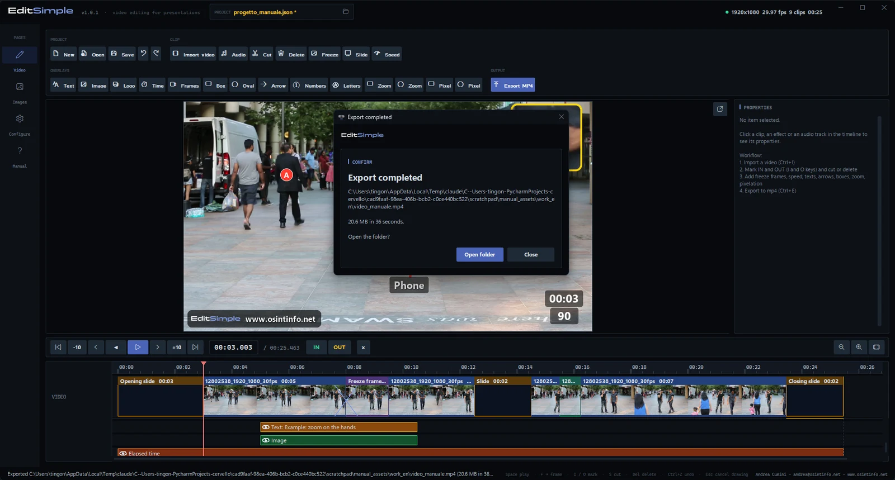

## 16. The Images page

The **Images** page (bar on the left) is for preparing a **figure for a
report or a presentation** starting from one or more photographs: the photos
on the sheet, the annotations on top, the numbered points with their notes
and the caption, to insert into Word with one click or to export as an
image. The example in this chapter uses two photos of a motorbike.

### 16.1 Layout and photographs

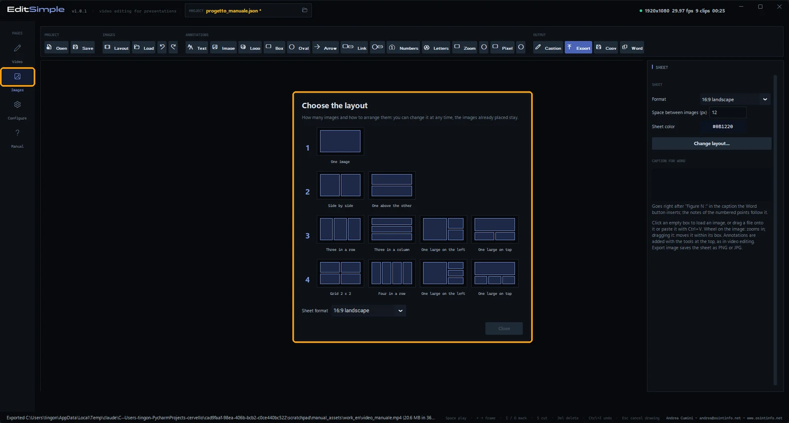

When you first open the page it asks for the **layout**: one image; two side
by side or one above the other; three in a row, in a column, one large on
the left or one large on top; four in a grid, in a row, one large on the
left or one large on top. Below you choose the **sheet format**: 16:9
(1920×1080), 4:3, square, 9:16 portrait or A4 portrait. Layout and format
can be changed at any time (**Layout** in the toolbar, or *Change layout...*
in the sheet panel): the images already placed stay.

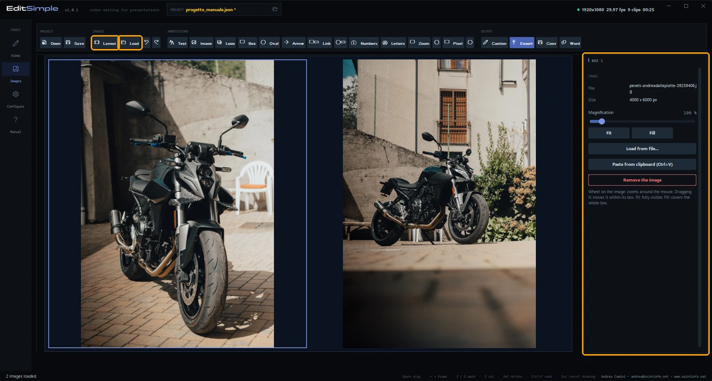

You place photographs with **Load** (one or more, into the chosen box and
the next empty ones), with a **click on an empty box**, by dragging a file
from your computer onto the box or with **Ctrl+V** from the clipboard (for
example a screenshot). Each photo fills its box: the **mouse wheel** over
the photo zooms in, **dragging it** moves it within the box to frame the
detail that matters. The photo panel shows the file name, the size, the zoom
slider and the buttons to replace or remove it. The **sheet** panel (when
nothing is selected) has the format, the space between the images and the
sheet color.

### 16.2 Annotations

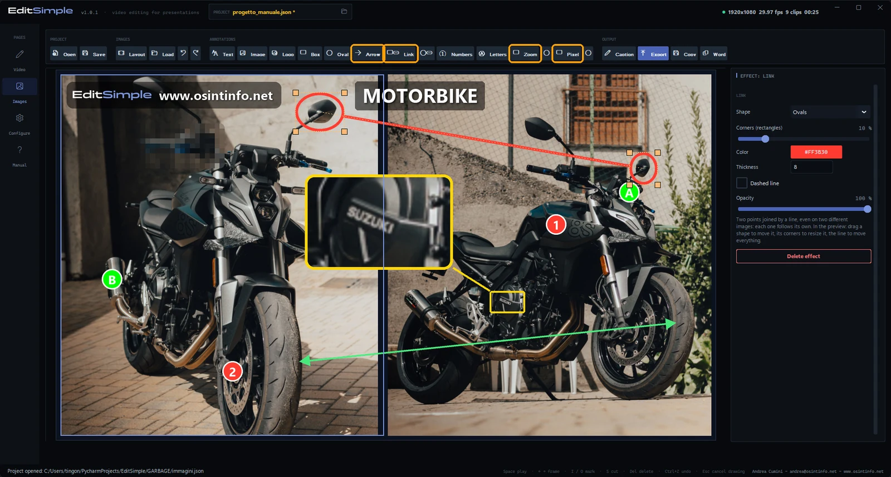

The tools are the same as for the video (**Text**, **Image**, **Logo**,
**Box**, **Oval**, **Arrow**, **Numbers**, **Letters**, rectangular and oval
**Zoom**, rectangular and oval **Pixel**), without timing or tracking, plus
a new one:

- **Link** (C rectangles, Shift+C ovals): one click on the first point and
  one on the second; a shape appears around each (rectangle or oval,
  resizable from the corners) and a line joins them edge to edge. In the
  panel: shape, corners, color, thickness, dashed line, opacity. It is there
  to say "this is that one": the detail of one photo found again in the
  other.

Each annotation **belongs to the photo it sits on**: if the photo is moved or
zoomed, the annotation follows it. An arrow or a link between two photos has
one end on each, and each end follows its own photo. An annotation that
straddles two photos (a text, a circle, a box) stays whole on the sheet.

### 16.3 Numbered points and notes

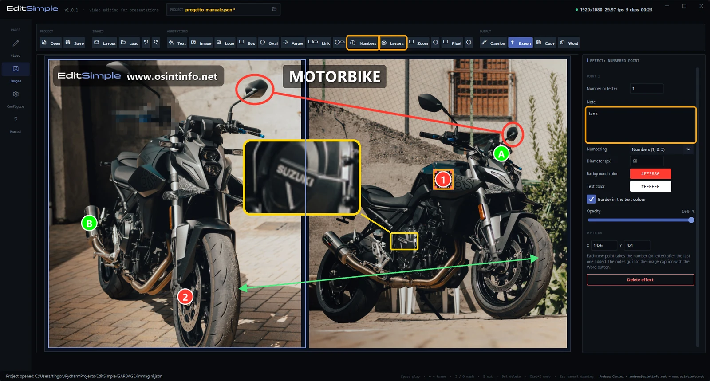

**Numbers** (N) and **Letters** (Shift+N) work as in the video: a click on
the button, a click on the photo, and the point takes the number or letter
after the last one. Here, in addition, each point has a **Note** in the
panel: what it marks. The notes go into the caption, in the order of the
points (numbers first, then letters). In the sheet panel the **Numbered
points** list shows all the points with their note: a click selects the
point.

### 16.4 Caption and Word

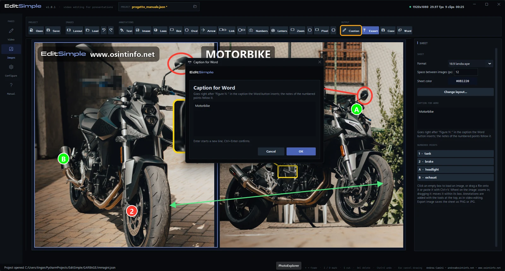

The **Caption** button (or the *Caption for Word* box in the sheet panel)
opens the caption text: it goes right after "Figure N :", and the notes of
the numbered points follow it. With the text "Motorbike" and four points the
caption becomes:

`Figure 1 : Motorbike. 1) tank, 2) brake, A) headlight, B) exhaust`

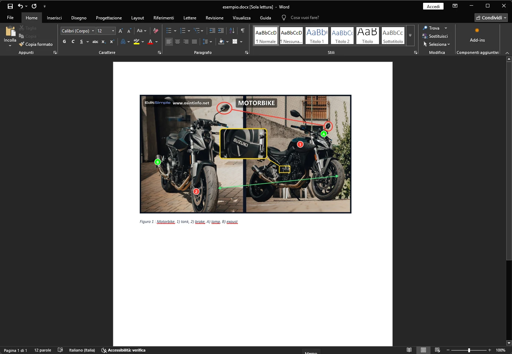

The **Word** button inserts the figure **into the open Word document, at the
cursor**: the image, as wide as the page, and below it the caption in Word's
*Caption* style, with the automatic number ("Figure 1", "Figure 2"...). The
number is a Word field: Word's **cross-references** and **table of figures**
work as they do for figures made by hand. If Word is not open, it is started
with a new document; if Word does not respond, the image and the caption are
copied to the clipboard, ready to paste.

### 16.5 Saving, exporting, copying

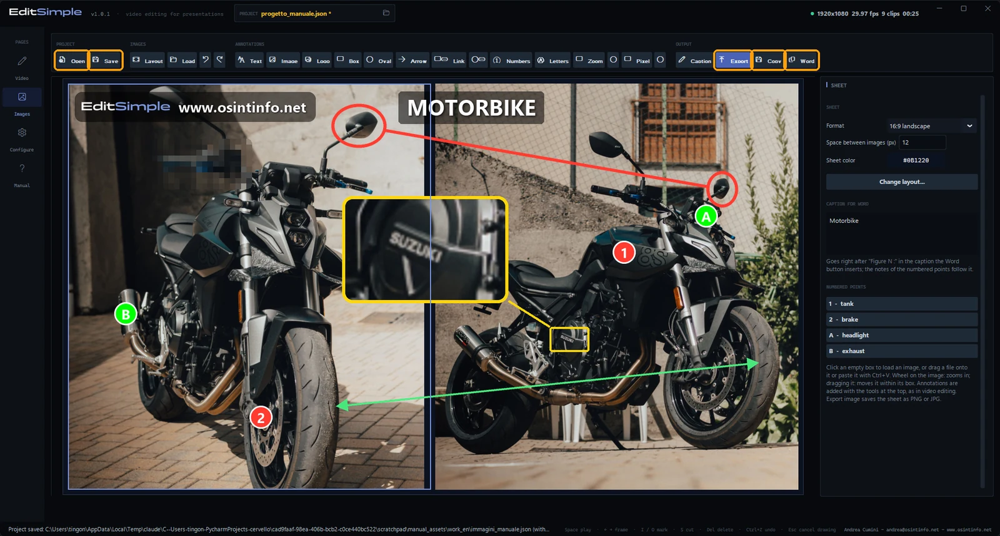

- **Save** (Ctrl+S, Ctrl+Shift+S to save as) writes the **project**: a JSON
  file with the layout, the format, the photos (framing and zoom), the
  annotations and the caption, and next to it a `<name>_file` folder with
  copies of the photos and of the images used. The JSON is readable and can
  be edited by hand. **Open** (Ctrl+O) reopens it; on closing, if something
  is not saved, the program asks.
- **Export** saves the sheet as **PNG or JPG** at the size of the format.
- **Copy** puts the sheet on the **clipboard**, to paste into an email, a
  presentation or elsewhere.
- Undo and redo (Ctrl+Z, Ctrl+Y) apply to everything: photos, annotations,
  layout and caption.

## 17. Tips for a good result

- **Put the zoom box in a neutral area**: the magnified box covers the part
  of the video it sits on, for the whole time it appears. Put it where
  nothing interesting happens (sky, wall, floor).
- **Draw tightly around the subject** for boxes, ovals and pixelations: the
  content of the shape is the template searched for in the following frames.
- **For the arrow and the numbered point, a slightly larger rectangle**
  (head and shoulders instead of just the head) holds up better when other
  people pass in front.
- **After tracking, scroll through the video**: where the shape goes wrong,
  drag it onto the subject. A few keyframes are enough even for long paths.
- **With many effects**, use the eye to hide the ones you don't need at the
  moment, and the detached preview to have more room in the timeline.
- **In images, arrange the photos first** (framing and zoom) and then the
  annotations: the annotations follow the photo, but it is easier to draw
  them on the final framing.
- **Save often** (Ctrl+S): the project is a small JSON file that you can
  reopen and edit whenever you want.

## 18. Keyboard and mouse shortcuts

| Key | Action |
| --- | --- |
| Space / Shift+Space | Play or pause / play backwards |
| ← → | One frame back / forward |
| Ctrl+← → | Ten frames back / forward |
| Shift+← → | One second back / forward |
| Home / End | Start / end of the video |
| I / O | Mark IN / OUT |
| S | Cut at the cursor |
| F | Freeze frame |
| V | Speed of the IN-OUT range |
| T / R / E / A | Text / box / oval / arrow |
| N / Shift+N | Numbered point with numbers / with letters |
| C / Shift+C | Link with rectangles / with ovals (Images page) |
| Z / Shift+Z | Rectangular / oval zoom |
| P / K | Rectangular / oval pixelation |
| L | Logo and operator |
| Delete | Delete the selection (or the IN-OUT range) |
| Esc | Cancel the drawing in progress |
| Ctrl+Z / Ctrl+Y | Undo / redo |
| Ctrl+N / Ctrl+O / Ctrl+S / Ctrl+Shift+S | New / open / save / save as (on the Images page: the image project) |
| Ctrl+I | Import video |
| Ctrl+V | Paste an image from the clipboard (Images page) |
| Ctrl+E | Export MP4 |

| Mouse | Where | Action |
| --- | --- | --- |
| Wheel | Preview | One frame forward or back |
| Ctrl+wheel | Preview | Zooms in the view |
| Drag on an empty spot, middle button | Zoomed-in preview | Pans the view |
| Double-click | Text in the preview | Rewrites the text |
| Ctrl+wheel | Timeline | Zooms in the timeline |
| Wheel / Alt+drag / middle button | Timeline | Scrolls horizontally |
| Shift+wheel, wheel over the names | Timeline | Scrolls audio and effects vertically |
| Right button | Effect bar | Extend to cursor / stop at cursor |
| Right button | Keyframe or point | Deletes |
| Wheel / drag | Photo on the Images page | Zooms / moves the photo within its box |
| Click on an empty box, dragged file | Images page | Loads a photo |

## 19. The project files

The **video** project is a JSON file with the clips, the audio tracks, the
effects (with the tracking paths and the keyframes) and the paths of the
files used. Videos, audio files and images are not copied into the project:
leave them where they are until the work is finished. The exported video, on
the other hand, is a self-contained MP4.

The **image** project is a JSON file (`kind: editsimple-images`) with the
layout, the format, the caption, the boxes with their photo and the
annotations, plus the `<name>_file` folder next to it with copies of the
photos, of the overlaid images and of the logo: the project is
self-contained and can be moved together with its folder. The values in the
JSON (coordinates, colors, notes, point labels) can be edited with a text
editor.

---

EditSimple is free software, distributed under the GNU GPL version 3 license
with additional author attribution terms (see `LICENSE` and `NOTICE`).
ffmpeg and VitTrack are separate programs with their own licenses.
